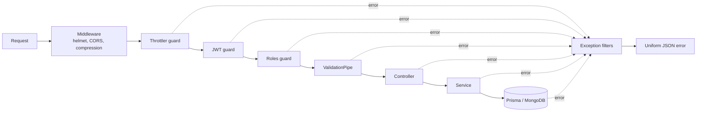

# Doctor Tracker API

REST backend for a secure admin portal that manages doctors and their patients, with login, search, filtering, pagination and dashboard analytics.

- Base URL: `http://localhost:8080/api/v1`
- Swagger docs: `http://localhost:8080/api/docs` (OpenAPI JSON at `/api/docs-json`)

## Table of Contents

- [Tech Stack](#tech-stack)
- [Architecture](#architecture)
- [Project Structure](#project-structure)
- [Getting Started](#getting-started)
- [Environment Variables](#environment-variables)
- [Default Credentials](#default-credentials)
- [Data Model and Indexes](#data-model-and-indexes)
- [Authentication and Authorization](#authentication-and-authorization)
- [API Reference](#api-reference)
- [Error Handling and Validation](#error-handling-and-validation)
- [Performance and Query Design](#performance-and-query-design)
- [Technical Decisions](#technical-decisions)
- [Deployment](#deployment)

## Tech Stack

| Layer | Choice | Role |
| --- | --- | --- |
| Framework | NestJS 12 on Express | Modules, dependency injection, guards, pipes, filters |
| Language | TypeScript 6, ES modules | Strict typing, `.js` extension on relative imports |
| Database | MongoDB Atlas | Document store, indexed for search, filter and pagination |
| ORM | Prisma 6 (`prisma-client-js`) | Typed queries, `groupBy`, `aggregateRaw` for analytics |
| Auth | JWT access + refresh tokens, Passport, bcrypt | Stateless sessions, role-based access |
| Validation | class-validator, class-transformer | DTO validation, type coercion of query strings |
| Docs | @nestjs/swagger | OpenAPI UI with bearer auth |
| Hardening | helmet, throttler, CORS, compression | Headers, rate limits, origin control, smaller payloads |
| Tooling | yarn, tsx, Vitest, oxlint | Install, seed script, tests, lint |

## Architecture

Every request runs the same pipeline: global middleware, three global guards, a validation pipe, the controller, the service and Prisma. An error at any stage ends in two global exception filters, so clients always receive one error shape.



Guard and pipe failures reach the same filters as controller, service and database errors.

## Project Structure

```
src/
├── main.ts                 bootstrap: helmet, CORS, prefix, pipes, filters, Swagger
├── app.module.ts           global guards: throttler, JWT, roles
├── config/swagger.config.ts
├── prisma/                 PrismaService in a global module
├── auth/                   login, refresh, logout, me, JWT strategy, guards
├── doctors/                doctor CRUD, search, filters, doctor-scoped patients
├── patients/               patient list, edit, delete, filters
├── dashboard/              summary, timeline, groupBy statistics
└── common/
    ├── decorators/         @Public, @Roles, @CurrentUser, @ApiCommonErrors
    ├── dto/                pagination query, error response
    ├── filters/            AllExceptionsFilter, PrismaExceptionFilter
    ├── pipes/              ParseObjectIdPipe
    └── utils/              pagination and date-range helpers
prisma/
├── schema.prisma
└── seed.ts
```

Feature modules never import each other. They share only the global `PrismaModule` and the helpers in `common/`.

## Getting Started

**Prerequisites:** Node.js, yarn and a MongoDB Atlas cluster (or any MongoDB replica set, because Prisma requires one).

```bash
yarn install
cp .env.example .env     # then fill in the values below
yarn db:generate         # generate the Prisma client
yarn db:push             # create collections and indexes (MongoDB has no migrate)
yarn db:seed             # admin, demo user, 12 doctors, sample patients
yarn start:dev           # http://localhost:8080/api/v1
```

## Environment Variables

| Variable | Example | Purpose |
| --- | --- | --- |
| `NODE_ENV` | `development` | Runtime mode |
| `PORT` | `8080` | API port |
| `CLIENT_URL` | `http://localhost:3000` | Allowed CORS origin (the Next.js app) |
| `DATABASE_URL` | `mongodb+srv://<user>:<password>@<cluster>/doctor_tracker?retryWrites=true&w=majority` | Atlas connection string, database `doctor_tracker` |
| `JWT_ACCESS_SECRET` | 96-character random hex | Signs access tokens |
| `JWT_ACCESS_EXPIRES_IN` | `15m` | Access token lifetime |
| `JWT_REFRESH_SECRET` | a different random hex | Signs refresh tokens |
| `JWT_REFRESH_EXPIRES_IN` | `7d` | Refresh token lifetime |
| `BCRYPT_SALT_ROUNDS` | `10` | Password hashing cost |
| `THROTTLE_TTL` / `THROTTLE_LIMIT` | `60000` / `100` | Global rate limit: requests per window (ms) |
| `ADMIN_EMAIL` / `ADMIN_PASSWORD` | `admin@example.com` / `Admin@12345` | Seeded admin account |
| `SEED_USER_EMAIL` / `SEED_USER_PASSWORD` | `user@example.com` / `User@12345` | Seeded read-only user |
| `SWAGGER_ENABLED` | `true` | Serves `/api/docs`; set `false` to hide in production |
| `DASHBOARD_TIMEZONE` | `Asia/Dhaka` | Timezone for date buckets in dashboard charts |

Generate each JWT secret with:

```bash
node -e "console.log(require('crypto').randomBytes(48).toString('hex'))"
```

Commit only `.env.example` with blank values, never `.env`.

## Default Credentials

| Role | Email | Password |
| --- | --- | --- |
| ADMIN | `admin@example.com` | `Admin@12345` |
| USER | `user@example.com` | `User@12345` |

> These are demo values for reviewers. Change them before any real deployment.

## Data Model and Indexes

Three collections hold all data: `users`, `doctors` and `patients`. One doctor has many patients, and deleting a doctor cascades to its patients. Every compound index ends in `createdAt` so filter-plus-sort queries are served from the index.

| Model | Fields | Notes |
| --- | --- | --- |
| User | `name`, `email` (unique), `passwordHash`, `role` (ADMIN or USER, default USER), `refreshTokenHash` | Refresh token stored as a SHA-256 hash |
| Doctor | `name`, `specialization`, `hospital`, `phone`, `email` (unique), `createdAt`, `updatedAt` | Has many patients |
| Patient | `name`, `age`, `gender` (MALE, FEMALE, OTHER), `phone`, `email?`, `condition`, `notes?`, `doctorId`, `createdAt`, `updatedAt` | `onDelete: Cascade` from Doctor |

### Indexes and the queries they serve

| Collection | Index | Query it serves |
| --- | --- | --- |
| doctors | `createdAt` desc | Default list, date filter, pagination |
| doctors | `specialization`, `createdAt` desc | Specialization filter with sort |
| doctors | `hospital`, `createdAt` desc | Hospital filter with sort |
| doctors | `name` | Prefix search by name |
| patients | `doctorId`, `createdAt` desc | A doctor's patient list, patients-per-doctor chart |
| patients | `createdAt` desc | Patients page, date filter, timeline chart |
| patients | `condition`, `createdAt` desc | Condition filter, conditions chart |
| patients | `name` | Prefix search by name |

Schema changes reach Atlas with `yarn db:push`, which also creates these indexes.

## Authentication and Authorization

Every route is protected by default. Only routes marked `@Public()` (login and refresh) skip the JWT check, and write routes add `@Roles(Role.ADMIN)`.

1. `POST /auth/login` checks the email and bcrypt password, then returns a 15-minute access token and a 7-day refresh token.
2. The client sends `Authorization: Bearer <accessToken>` on each request.
3. When the access token expires, `POST /auth/refresh` returns a new pair. The refresh token must match its stored SHA-256 hash, so a token that was replaced or revoked is rejected.
4. `POST /auth/logout` clears the stored hash and revokes the refresh token.

Three global guards run in a fixed order: the throttler (rate limit), the JWT guard, then the roles guard. Login is limited to 5 requests per minute, all other routes to 100.

### Permissions by role

| Action | ADMIN | USER |
| --- | :---: | :---: |
| Log in, view dashboard | Yes | Yes |
| List, search, filter doctors and patients | Yes | Yes |
| Create a doctor | Yes | No |
| Add a patient under a doctor | Yes | No |
| Edit or delete a patient | Yes | No |

A missing or expired token returns `401`. A valid token without the required role returns `403`.

Refresh tokens are hashed with SHA-256, not bcrypt, because bcrypt reads only the first 72 bytes and every JWT starts with the same header, so any token would match.

## API Reference

All paths sit under `/api/v1` and, except login and refresh, need a bearer token. The live, testable version is the Swagger UI at `/api/docs`.

### Auth

| Method | Path | Role | Purpose |
| --- | --- | --- | --- |
| POST | `/auth/login` | Public | Email and password, returns tokens and user |
| POST | `/auth/refresh` | Public | Exchange a refresh token for a new pair |
| POST | `/auth/logout` | Any | Revoke the refresh token |
| GET | `/auth/me` | Any | Current user |

### Doctors

| Method | Path | Role | Purpose |
| --- | --- | --- | --- |
| POST | `/doctors` | ADMIN | Create a doctor |
| GET | `/doctors` | Any | List with search, filters, pagination |
| GET | `/doctors/filter-options` | Any | Distinct specializations and hospitals for dropdowns |
| GET | `/doctors/:id` | Any | One doctor with `patientCount` |
| GET | `/doctors/:id/patients` | Any | A doctor's patients with search, filters, pagination |
| POST | `/doctors/:id/patients` | ADMIN | Add a patient under the doctor |
| DELETE | `/doctors/:id/patients/:patientId` | ADMIN | Remove a patient from the doctor's list |

### Patients

| Method | Path | Role | Purpose |
| --- | --- | --- | --- |
| GET | `/patients` | Any | List all patients, each with its doctor |
| GET | `/patients/filter-options` | Any | Distinct conditions for the filter dropdown |
| GET | `/patients/:id` | Any | One patient |
| PATCH | `/patients/:id` | ADMIN | Edit any subset of fields |
| DELETE | `/patients/:id` | ADMIN | Delete a patient |

### Dashboard

| Method | Path | Chart | Purpose |
| --- | --- | --- | --- |
| GET | `/dashboard/summary` | Stat cards | Totals, average patients per doctor, 30-day growth |
| GET | `/dashboard/patients-per-doctor` | Bar | Top doctors by patient count (`limit`, max 50) |
| GET | `/dashboard/timeline` | Line or area | New patients and doctors by `interval=day` or `month`, with `from` and `to` as `YYYY-MM-DD` |
| GET | `/dashboard/conditions` | Donut | Most common conditions (`limit`) |
| GET | `/dashboard/specializations` | Bar | Doctors per specialization (`limit`) |

### List query parameters

| Parameter | Doctors | Patients | Notes |
| --- | :---: | :---: | --- |
| `page`, `limit` | Yes | Yes | Defaults 1 and 10, limit up to 100 |
| `sortOrder` | Yes | Yes | `asc` or `desc`, default `desc` |
| `sortBy` | `createdAt`, `name` | `createdAt`, `name`, `age` | Default `createdAt` |
| `search` | Yes | Yes | Case-insensitive, over name, email and more |
| `specialization`, `hospital` | Yes | No | Exact match |
| `condition`, `gender`, `doctorId` | No | Yes | Exact match |
| `dateFrom`, `dateTo` | Yes | Yes | Created range, `YYYY-MM-DD` includes the whole end day |

List endpoints return:

```json
{
  "data": [],
  "meta": { "page": 1, "limit": 10, "total": 0, "totalPages": 0 }
}
```

## Error Handling and Validation

Every failure returns the same JSON shape, whether it comes from validation, auth, the database or an unexpected crash:

```json
{
  "success": false,
  "statusCode": 400,
  "message": ["email must be an email"],
  "path": "/api/v1/auth/login",
  "timestamp": "2026-11-20T10:50:41.623Z"
}
```

- **Validation:** a global `ValidationPipe` with `whitelist`, `forbidNonWhitelisted` and `transform` strips unknown fields, rejects extra ones with 400, and converts query strings to numbers. DTOs also trim text and lowercase emails.
- **AllExceptionsFilter:** the catch-all. It passes `HttpException` status and message through, and for anything else it logs the stack and returns a generic 500, so internals never reach the client.
- **PrismaExceptionFilter:** translates known database errors into clean HTTP responses and takes priority over the catch-all.
- **ParseObjectIdPipe:** rejects a malformed MongoDB id with 400 before it reaches the database.

| Prisma code | HTTP status | Message |
| --- | :---: | --- |
| `P2002` unique constraint | 409 | Duplicate value for the field, such as a doctor email |
| `P2025` record not found | 404 | Record not found |
| `P2023` malformed id | 400 | Invalid ID format |
| `P2014` relation violation | 400 | Relation constraint violation |
| Any other code | 500 | Database error, logged server-side |

Other status codes: `401` for a missing or invalid token, `403` for a missing role, and `429` when the rate limit is exceeded.

## Performance and Query Design

All counting and grouping runs inside MongoDB, and independent queries run in parallel, so no endpoint loads a full collection into memory.

| Concern | Approach |
| --- | --- |
| Pagination | `skip` and `take` with a page count from one parallel count query; limit capped at 100 |
| Stable ordering | Every sort adds `id` as a tie-breaker, so rows with equal `createdAt` never repeat or vanish between pages |
| Search | Case-insensitive `contains` over a few fields. MongoDB can use an index only for prefix matches, which is fine at this scale; Atlas Search is the upgrade path |
| Filters | Exact-match fields sit in compound indexes that end in `createdAt` |
| Date range | `dateTo` as `YYYY-MM-DD` is extended to the end of that day so the last day is included |
| Dropdown data | `filter-options` endpoints use `groupBy`, so the UI never scans full lists |
| Doctor list | `patientCount` comes from one relation count per page, so the UI needs no extra request |

### Dashboard aggregation

- **Summary:** six count queries run in parallel: two totals, and new versus previous 30 days for doctors and for patients. Growth is `null` when the earlier period is empty.
- **Patients per doctor:** one `groupBy` on `doctorId` ordered by count, then one lookup of those doctors' names.
- **Conditions and specializations:** a single `groupBy` each, ordered by count with a limit.
- **Timeline:** one `aggregateRaw` `$group` per collection, bucketed by day with `$dateToString` in the configured timezone. Missing days are filled with zero in code, and the same rows roll up into months when `interval=month`.
- **Guard rails:** a timeline range is capped at 1100 days, and the daily interval at 366 days, so one request cannot overload the server.

The timeline query pads the date range by one day on each side and discards out-of-range days afterward. This keeps buckets correct at the edges when the timezone is ahead of UTC.

## Technical Decisions

### 1. Prisma with MongoDB, and aggregation pushed to the database

The API uses Prisma on MongoDB so queries are typed end to end and schema indexes live next to the models. Dashboard numbers come from `count`, `groupBy` and a raw `$group` pipeline instead of loading records and counting in JavaScript.

- **Why:** an admin dashboard recomputes on every visit. Database-side aggregation keeps memory flat and latency tied to index size, not row count.
- **Trade-off:** Prisma's MongoDB connector has no full-text search and cannot bucket by date, so search is prefix-friendly regex and the timeline uses `aggregateRaw`. It also needs a replica set, which Atlas provides.
- **Alternative rejected:** Mongoose gives native aggregation and text indexes, but it loses the generated types and the shared `Prisma.*WhereInput` filters used across modules.

### 2. Global guards with deny-by-default routes and hashed refresh tokens

The throttler, JWT guard and roles guard are registered once as global guards. Every new route is protected automatically, and a route opts out only with `@Public()` or opts into a stricter rule with `@Roles()`.

- **Why:** per-controller guards fail open when someone forgets one. A global guard makes that mistake impossible, which matters for an app whose whole purpose is protecting patient data.
- **Refresh tokens:** the server stores only a SHA-256 hash of the current refresh token. A stolen database dump yields no usable tokens, and logging out revokes the session server-side.
- **Trade-off:** one refresh token per user means a second login on another device replaces the first. Per-device sessions would need a separate sessions collection.
- **Why not bcrypt for tokens:** bcrypt reads only 72 bytes, and JWTs share a long common prefix, so a comparison would accept the wrong token.

## Deployment

Deploy the API to any Node host (Render, Railway, Fly or a VPS) with environment variables set in the host's dashboard, not from a committed `.env`.

```bash
yarn install && yarn build   # runs prisma generate, then nest build
yarn db:push                 # once, and after any schema or index change
yarn start:prod              # node dist/main
```

### Pre-submission checklist

- [ ] Replace the Atlas database password, because it was shared outside the project
- [ ] Create a database user limited to `readWrite` on `doctor_tracker`
- [ ] Add the server's IP to Atlas Network Access
- [ ] Generate new `JWT_ACCESS_SECRET` and `JWT_REFRESH_SECRET` for production
- [ ] Set `CLIENT_URL` to the deployed frontend origin
- [ ] Confirm `.env` is in `.gitignore` and commit only `.env.example`
- [ ] Run `yarn db:seed` against the production database, then change the demo passwords
- [ ] Open `/api/docs`, log in as ADMIN and USER, and confirm a USER receives 403 on `POST /doctors`
- [ ] Decide whether `SWAGGER_ENABLED` stays true for reviewers
- [ ] Put the demo credentials, the architecture overview and two technical decisions in the README

---

Author: Sajib Sarker
